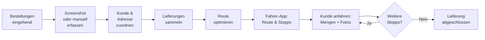

# 🍝 Liefermanagement-Software für eine Nudelfabrik

**Projektbeschreibung · Funktionsumfang**

> Eine Software, die den gesamten Lieferprozess der Nudelfabrik vereinfacht – von der
> Bestellerfassung über die automatische Routenoptimierung bis zur mobilen Fahrer-App.

---

## Inhalt

1. [Ziel der Software](#1-ziele-der-software)
2. [Kundenverwaltung](#2-kundenverwaltung)
3. [Bestellungen erfassen](#3-bestellungen-erfassen)
4. [Automatische Routenoptimierung](#4-automatische-routenoptimierung)
5. [Fahrer-App](#5-fahrer-app)
6. [Fotos der Geschäfte und Parkmöglichkeiten](#6-fotos-der-geschäfte-und-parkmöglichkeiten)
7. [Ablauf im täglichen Betrieb](#7-ablauf-im-täglichen-betrieb)
8. [Benötigte Softwarebereiche](#8-benötigte-softwarebereiche)
9. [Zusammenfassung](#9-zusammenfassung)

---

## 1. Ziele der Software

Der Kunde betreibt eine **Nudelfabrik** und liefert seine Nudeln regelmäßig an verschiedene
Geschäftskunden, beispielsweise Restaurants. Er möchte eine Software entwickeln lassen, die den
gesamten Lieferprozess vereinfacht.

**Hauptziel:** Der Lieferfahrer soll die App öffnen und sofort wissen:

- ✅ Welche Kunden er heute beliefern muss.
- ✅ In welcher Reihenfolge er die Kunden anfahren soll.
- ✅ Welche Route am schnellsten bzw. effizientesten ist.
- ✅ Welche Nudelsorten und Mengen jeder Kunde bestellt hat.
- ✅ Wie das Geschäft aussieht und wo er parken bzw. entladen kann.

---

## 2. Kundenverwaltung

In der Software werden **alle Kunden der Nudelfabrik** gespeichert.

| Feld | Beschreibung | Pflicht |
| --- | --- | --- |
| Kundenname | Name bzw. Geschäftsname des Kunden | Ja |
| Kundennummer | Eindeutige Nummer zur Identifikation | Ja |
| Lieferadresse | Adresse für die Anlieferung | Ja |
| Geschäftsfoto | Foto vom Geschäft bzw. Geschäftseingang | Ja |
| Parkplatzfoto | Foto der Park- oder Entlademöglichkeit | Ja |
| Hinweise | Optionale Hinweise für den Lieferfahrer | Nein |

> **Wichtig:** Die Kundeninformationen werden dauerhaft gespeichert, damit sie bei jeder neuen
> Lieferung wiederverwendet werden können.

---

## 3. Bestellungen erfassen

Die Nudelfabrik benötigt eine Möglichkeit, Kundenbestellungen in die Software einzutragen.
Dafür gibt es **zwei Wege**:

### A. Bestellung per Screenshot

- [ ] Screenshot der erhaltenen Bestellung hochladen
- [ ] Bestellung dem richtigen Kunden zuordnen
- [ ] Benötigte Nudelsorten und Mengen erfassen bzw. überprüfen

### B. Manuelle Eingabe

- [ ] Kunden auswählen
- [ ] Bestellte Nudelsorten auswählen
- [ ] Jeweilige Mengen eintragen
- [ ] Bestellung speichern

Alle Bestellungen erscheinen anschließend in einer **zentralen Bestellübersicht**.

> ❓ **Offener Punkt:** Ob die Informationen aus Screenshots automatisch durch KI erkannt werden
> sollen, muss noch festgelegt werden.

---

## 4. Automatische Routenoptimierung

Die Software erstellt anhand der erfassten Bestellungen automatisch eine möglichst effiziente
Lieferroute. Dazu soll sie:

- Alle Kunden berücksichtigen, die beliefert werden müssen.
- Die Lieferadressen auf einer Karte anzeigen.
- Eine möglichst zeitsparende Fahrreihenfolge berechnen.
- Die Route für den Lieferfahrer bereitstellen.
- Die zugehörigen Bestellungen und Mengen jedem Lieferstopp zuordnen.

> **Ziel:** Der Fahrer soll nicht selbst überlegen müssen, welchen Kunden er zuerst anfährt.

---

## 5. Fahrer-App

Der Lieferfahrer erhält eine **einfache mobile Ansicht**, die er während seiner Arbeit verwendet.

### Beim Öffnen sieht er

| Anzeige | Inhalt |
| --- | --- |
| Heutige Lieferungen | Alle für heute geplanten Stopps |
| Optimierte Route | Vom System berechnete Fahrtstrecke |
| Reihenfolge | Nummerierte Lieferstopps |
| Nächster Kunde | Name und Adresse des nächsten Stopps |
| Bestelldaten | Nudelsorten und Mengen |

### Bei Auswahl eines Kunden sieht er zusätzlich

- Den **Namen des Geschäfts**.
- Die **genaue Lieferadresse**.
- Ein **Foto vom Geschäft bzw. Eingang**.
- Ein **Foto der Park- oder Entlademöglichkeit**.
- Die **benötigten Nudelsorten und Mengen**.

> 🧭 Über eine **Navigationsfunktion** gelangt der Fahrer direkt zum nächsten Lieferstopp.

---

## 6. Fotos der Geschäfte und Parkmöglichkeiten

Ein besonders wichtiger Bestandteil der Software ist die **Fotodokumentation der Kundenstandorte**.

| Foto | Zweck |
| --- | --- |
| **Geschäftsfoto** | Damit der Fahrer das richtige Geschäft bzw. den richtigen Eingang schnell erkennt. |
| **Parkplatzfoto** | Damit der Fahrer weiß, wo sich eine geeignete und erlaubte Park- bzw. Entlademöglichkeit befindet. |

Die Fotos werden im jeweiligen **Kundenprofil gespeichert** und bei zukünftigen Lieferungen
automatisch angezeigt.

**Nutzen:** Auch neue Fahrer finden Kunden leichter, ohne jedes Mal nachfragen zu müssen.

---

## 7. Ablauf im täglichen Betrieb

1. Die Nudelfabrik erhält die Bestellungen ihrer Kunden.
2. Die Bestellungen werden per Screenshot oder manuell in die Software eingetragen.
3. Jede Bestellung wird einem Kunden und seiner Lieferadresse zugeordnet.
4. Die Software sammelt die anstehenden Lieferungen.
5. Die Software berechnet die optimierte Lieferroute.
6. Der Fahrer öffnet die App und sieht seine geplante Route.
7. Er fährt den ersten Kunden an.
8. In der App sieht er die benötigten Nudelmengen, das Geschäftsfoto und die Parkmöglichkeit.
9. Nach der Lieferung fährt er zum nächsten Kunden.
10. Der Vorgang wird wiederholt, bis alle Lieferungen abgeschlossen sind.

---

## 8. Benötigte Softwarebereiche

Die Software besteht aus **zwei Hauptbereichen**:

### A. Verwaltungsbereich für die Nudelfabrik

- Kunden anlegen und verwalten
- Kundenadressen und Fotos speichern
- Bestellungen erfassen
- Bestellübersicht anzeigen
- Lieferrouten erstellen und einsehen

### B. Mobiler Bereich für die Lieferfahrer

- Heutige Lieferungen anzeigen
- Optimierte Route aufrufen
- Navigation starten
- Bestellungen und Nudelmengen einsehen
- Geschäfts- und Parkplatzfotos ansehen

---

## 9. Zusammenfassung

Der Kunde benötigt eine **Liefermanagement-Software** mit Bestellverwaltung, automatischer
Routenoptimierung und einer mobilen Fahrer-App.

Die Software soll den täglichen Arbeitsaufwand der Nudelfabrik reduzieren und die Auslieferung der
Nudeln **einfacher, schneller und übersichtlicher** gestalten.

### Besonders wichtig

| Priorität | Anforderung |
| --- | --- |
| 🔴 Hoch | Einfache Bedienung |
| 🔴 Hoch | Anzeige der korrekten Liefermengen |
| 🔴 Hoch | Optimierte Fahrstrecke |
| 🔴 Hoch | Gespeicherte Fotos der Geschäfte und Parkmöglichkeiten |

---

*Projektbeschreibung – Liefermanagement-Software für eine Nudelfabrik*
